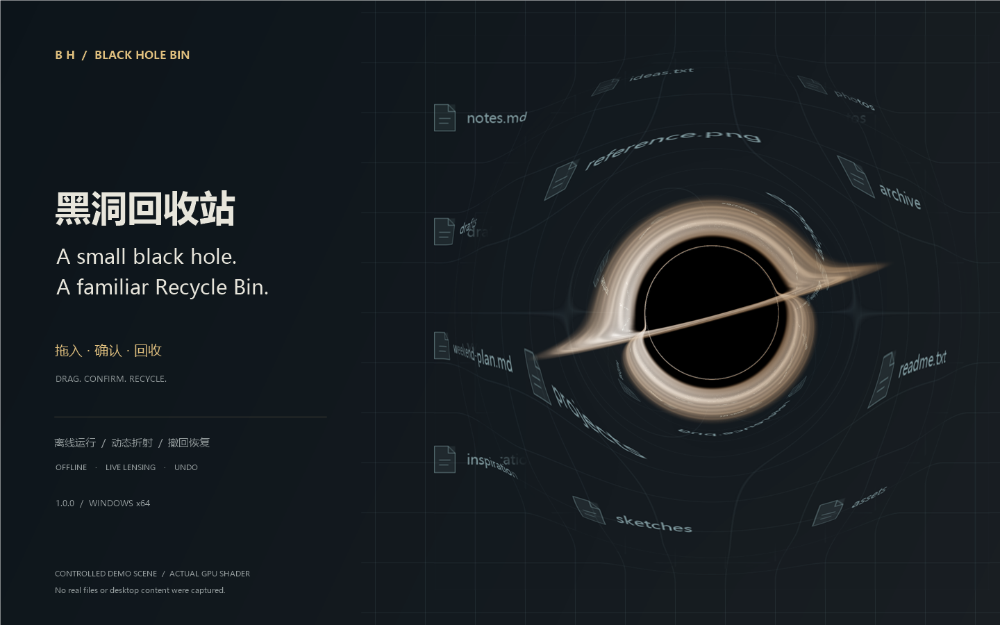
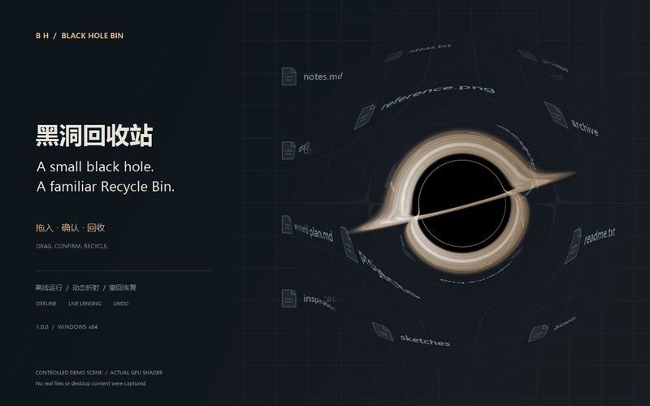

# BlackHoleBin

[简体中文](README.zh-CN.md) · English

A small black hole on your Windows desktop. Drop files into it, confirm, and send them to the Windows Recycle Bin.



## Features

- Animated accretion disk and live background lensing; updates while dragging.
- Confirmation, undo for the latest operation, and optional local recovery copies.
- Critical-folder protection, folder blacklist/whitelist, and a 10–2048 MB per-file limit.
- Size, color, animation, startup and visibility settings. Chinese / English UI.
- Offline at runtime. No telemetry, account or API key required.

## Run

[Download Windows x64 · 1.0.0](https://github.com/chiwuSL/BlackHoleBin/releases/download/v1.0.0/BlackHoleBin-v1.0.0.zip), extract it, and run `BlackHoleBin.exe`. Keep `BlackHoleGpu.dll` beside the EXE. Exit any older instance first. [All releases](https://github.com/chiwuSL/BlackHoleBin/releases).

Requires Windows 10/11 x64, .NET Framework 4.8 and a Direct3D 11-capable GPU. Right-click the black hole or tray icon for settings, show/hide and undo.

## Watch



[Watch / download the 8-second MP4](https://github.com/chiwuSL/BlackHoleBin/releases/download/v1.0.0/BlackHoleBin-lensing-demo.mp4) · [GIF](docs/media/demo.gif). The moving black hole bends a simulated desktop's file labels, icons and grid using the shipped GPU shader. No real desktop or files were captured; this shows the effect, not a recorded deletion.

## Build

Install Visual Studio Build Tools with Desktop C++, Windows SDK 10.0.26100, and .NET Framework 4.8. From PowerShell:

```powershell
.\build.ps1
.\tests\run-tests.ps1 -IncludeRecycleIntegration
```

The build currently expects MSVC at `C:\BuildTools`; adjust `native/build-native.ps1` if installed elsewhere. Integration tests need a normal interactive Windows session and use temporary files.

## Privacy & safety

Background images stay in memory. Recovery copies are **unencrypted local files** in `%LOCALAPPDATA%\BlackHoleBin\Recovery`; original paths/settings are stored under `HKCU\Software\BlackHoleBin`. Backups and undo have limits—keep independent backups of important files. [Security notes](SECURITY.md) · [Audit (中文)](docs/SECURITY-AUDIT-1.0.zh-CN.md).

## Credits

The renderer adapts the Schwarzschild shader from [Singularity](https://github.com/GreenScreen410/singularity), which credits [ghostty-blackhole](https://github.com/s0xDk/ghostty-blackhole) and [Eric Bruneton's work](https://ebruneton.github.io/black_hole_shader/). The desktop capture pipeline differs from upstream.

[MIT](LICENSE) · [Third-party notices](THIRD-PARTY-NOTICES.md)
