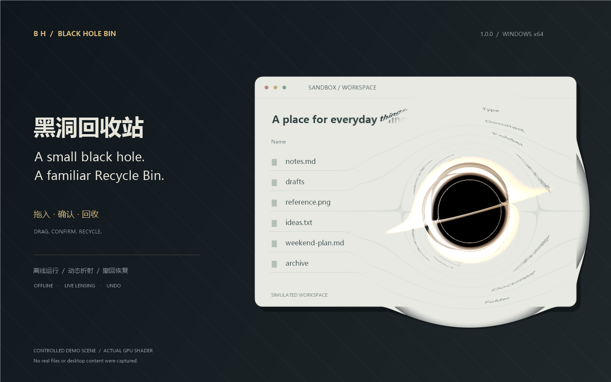
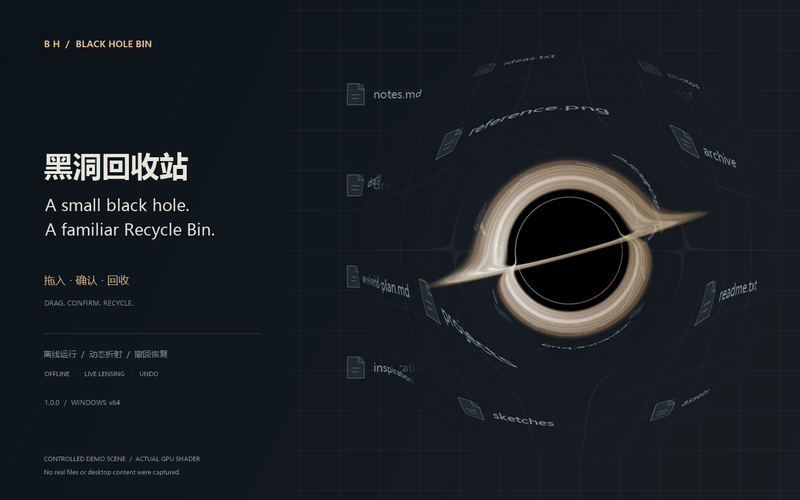

# 黑洞回收站 · BlackHoleBin

简体中文 · [English](README.md)

桌面上的一颗小黑洞。拖入文件，确认后移入 Windows 回收站。



## 功能

- 动态吸积盘与实时背景折射，拖动过程中持续更新。
- 回收确认、撤回最近一次操作、可选本地恢复保险副本。
- 关键目录保护、目录黑白名单、单文件 10–2048 MB 大小上限。
- 大小、配色、动画、开机启动及显示设置；支持中英文界面。
- 运行时完全离线，无遥测，无需账号或 API Key。

## 使用

[下载 Windows x64 · 1.0.0](https://github.com/chiwuSL/BlackHoleBin/releases/download/v1.0.0/BlackHoleBin-v1.0.0.zip)，解压后运行 `BlackHoleBin.exe`，保持 `BlackHoleGpu.dll` 同目录。升级前先从托盘退出旧版。[全部版本](https://github.com/chiwuSL/BlackHoleBin/releases)。

需要 Windows 10/11 x64、.NET Framework 4.8 和支持 Direct3D 11 的显卡。右键黑洞或托盘图标可进入设置、显示/隐藏、撤回。

## 效果演示



[观看 / 下载 6 秒 MP4](docs/media/demo.mp4)。素材使用虚构工作台及程序当前 GPU 着色器生成，未采集真实桌面或文件；视频展示特效，不是实际删除操作录像。

## 构建

安装 Visual Studio C++ Build Tools、Windows SDK 10.0.26100 和 .NET Framework 4.8，然后在 PowerShell 运行：

```powershell
.\build.ps1
.\tests\run-tests.ps1 -IncludeRecycleIntegration
```

构建脚本当前使用 `C:\BuildTools` 下的 MSVC；如路径不同，请修改 `native/build-native.ps1`。集成测试需在普通 Windows 交互会话中运行，使用临时文件。

## 隐私与安全

背景图像仅在内存处理。保险库为**未加密的本地副本**，位于 `%LOCALAPPDATA%\BlackHoleBin\Recovery`；设置和原路径记录保存在 `HKCU\Software\BlackHoleBin`。恢复功能有边界，重要文件仍应单独备份。[安全说明](SECURITY.md) · [审查报告](docs/SECURITY-AUDIT-1.0.zh-CN.md)。

## 致谢

渲染器移植自 [Singularity](https://github.com/GreenScreen410/singularity) 的 Schwarzschild 着色器，其上游包括 [ghostty-blackhole](https://github.com/s0xDk/ghostty-blackhole) 与 [Eric Bruneton 的研究](https://ebruneton.github.io/black_hole_shader/)。本程序的桌面捕获架构与上游不同。

[MIT 许可证](LICENSE) · [第三方声明](THIRD-PARTY-NOTICES.md)
